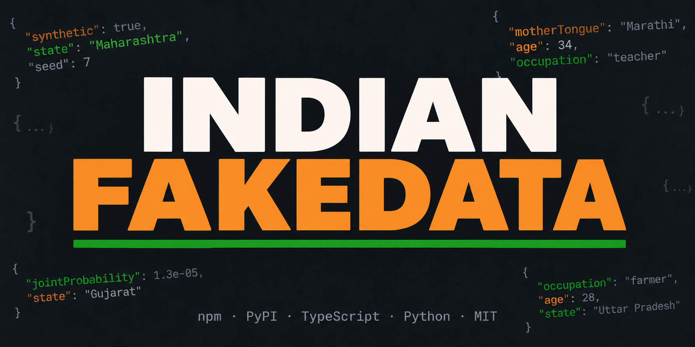

# Indian Fake Data Generator



[](https://www.npmjs.com/package/@abhay557/indian-fakedata)
[](https://pypi.org/project/indian-fakedata/)
[](https://www.python.org/)
[](https://www.typescriptlang.org/)
[](https://github.com/Abhay557/indian-fakedata/blob/main/LICENSE)
[](https://colab.research.google.com/drive/1VWYsjM0f6CxEi7pZ6uOa1i9Hfh7tsH8s?usp=sharing)

A library that generates realistic fake Indian profiles, built to match **Census 2011** and other public survey numbers.

Many fake-data tools mix details that don't fit together (like a *Sikh* named *Mohammed Sharma* from *Mizoram*). This library links the fields to each other, so the details of each profile fit together the way they do in real life.

This repository provides **two native implementations**:

1. A **Node.js / TypeScript** package: [`@abhay557/indian-fakedata`](https://www.npmjs.com/package/@abhay557/indian-fakedata)
2. A **Python** package: [`indian-fakedata`](https://pypi.org/project/indian-fakedata/)

> **All data is synthetic.** Names, IDs, and numbers are randomly generated and do not correspond to any real individuals. See [Acceptable Use](#acceptable-use).

**Links:** [Docs](https://abhay557.github.io/indian-fakedata/) · [Tutorial](https://github.com/Abhay557/indian-fakedata/blob/main/TUTORIAL.md) · [Changelog](https://github.com/Abhay557/indian-fakedata/blob/main/CHANGELOG.md) · [Colab demo](https://colab.research.google.com/drive/1VWYsjM0f6CxEi7pZ6uOa1i9Hfh7tsH8s?usp=sharing)

## Table of Contents

- [Installation](#installation)
- [Quick Start](#quick-start)
- [Output Sample](#output-sample)
- [The 4 Data Layers](#the-4-data-layers)
- [CLI Usage](#cli-usage-both-languages)
- [Programmatic API](#programmatic-api)
- [Data Sources & Real-World Accuracy](#data-sources--real-world-accuracy)
- [Contributing](#contributing)
- [For AI Agents](#for-ai-agents)
- [Acceptable Use](#acceptable-use)
- [License](#license)

---

## Installation

### Node.js / TypeScript

```bash
npm install @abhay557/indian-fakedata
```

Requires **Node.js >= 18**.

### Python

```bash
pip install indian-fakedata
```

Requires **Python 3.8+**.

---

## Quick Start

**Node.js / TypeScript**

```ts
import { generateUser } from '@abhay557/indian-fakedata';

const user = generateUser({ seed: 7 });
```

**Python**

```python
from indian_fakedata import generate_user

user = generate_user(seed=7)
```

**CLI**

```bash
indian-fakedata -c 1000 -f csv -o profiles.csv
```

> **Seeds:** the same seed always gives the same profile, as long as you use the same version and the same language (Node or Python). The two languages use random numbers differently, so one seed gives different results in each. A new release can also change what a seed gives. See the [Changelog](https://github.com/Abhay557/indian-fakedata/blob/main/CHANGELOG.md).

---

## Output Sample

One profile, `seed = 7`, generated by the **Python implementation**.

<details>
<summary>Click to expand the full JSON profile</summary>

```json
{
  "id": "72714162-6024-4710-9512-172321111444",
  "synthetic": true,
  "generator": "indian-fakedata@2.1.1",
  "firstName": "Pushpa",
  "lastName": "Sharma",
  "fatherName": "Santosh Sharma",
  "motherName": "Geeta Sharma",
  "spouseName": "Sanjay Sharma",
  "gender": "female",
  "age": 34,
  "dateOfBirth": "1992-06-11",
  "bloodGroup": "B+",
  "heightCm": 144.0,
  "weightKg": 44.1,
  "bmi": 21.3,
  "appearance": {
    "heightCm": 144.0,
    "build": "average",
    "faceShape": "round",
    "skinTone": "deep_brown",
    "noseType": "button",
    "eyeColor": "dark_brown",
    "eyeShape": "almond",
    "hairColor": "black",
    "hairTexture": "wavy",
    "hairLength": "medium",
    "facialHair": null
  },
  "aadhaarNumber": "500233102039",
  "panNumber": "EKIPS1361D",
  "voterIdNumber": "MHR0314014",
  "phoneNumber": "7501311043",
  "email": "pushpasharma352@gmail.com",
  "state": "Maharashtra",
  "stateCode": "MH",
  "district": "Kolhapur",
  "areaType": "urban",
  "addressLine": "245/D, Market Yard, Kolhapur",
  "locality": "Market Yard",
  "pinCode": "412519",
  "religion": "Hindu",
  "caste": "Deshastha Brahmin",
  "socialCategory": "General",
  "motherTongue": "Marathi",
  "secondLanguage": "Hindi",
  "education": "secondary",
  "occupation": "agricultural_labourer",
  "employmentSector": "self_employed",
  "maritalStatus": "married",
  "annualIncomeINR": 194000,
  "monthlyExpenditureINR": 15600,
  "numberOfChildren": 1,
  "dietaryPreference": "vegetarian",
  "disability": "none",
  "isMigrant": true,
  "migrationOriginState": "Andhra Pradesh",
  "bankIFSC": "SBIN0331430",
  "bankName": "State Bank of India",
  "bankAccountNumber": "00313113041",
  "rationCardType": "APL",
  "healthInsurance": "none",
  "landOwnershipAcres": 0,
  "vehicleRegistration": "MH 02 BB 2481",
  "vehicleType": "four_wheeler",
  "hasInternetAccess": true,
  "hasSmartphone": true,
  "usesSocialMedia": true,
  "upiId": "pushpa@okicici",
  "personality": {
    "openness": 54,
    "conscientiousness": 62,
    "extraversion": 60,
    "agreeableness": 70,
    "neuroticism": 58
  },
  "personalityTraits": {
    "summary": "An outgoing, people-oriented person who is practical, disciplined and kind-hearted. They feel things deeply and care about those around them.",
    "strengths": [
      "prefers familiar routines",
      "organized and punctual",
      "compassionate and helpful"
    ],
    "weaknesses": [
      "worries about small things",
      "needs company to feel energised",
      "perfectionist, can be rigid"
    ],
    "traitLabels": [
      "practical",
      "disciplined",
      "outgoing",
      "kind-hearted",
      "sensitive"
    ],
    "communicationStyle": "polite_indirect",
    "decisionStyle": "analytical",
    "socialBehavior": "outgoing"
  },
  "politicalLeaning": "nationalist_right",
  "religiosity": "very_religious",
  "cognitiveProfile": {
    "aptitudeScore": 74,
    "numeracyScore": 68,
    "literacyScore": 75,
    "digitalLiteracyScore": 53,
    "financialLiteracyScore": 71
  },
  "interests": {
    "primarySport": "cricket",
    "petPreference": "birds",
    "entertainment": [
      "Bollywood",
      "TV Serials",
      "Cricket Matches",
      "News",
      "YouTube",
      "OTT/Netflix"
    ],
    "readingHabit": "occasional",
    "musicPreference": "Bollywood",
    "preferredSocialMedia": "WhatsApp"
  },
  "habits": {
    "tobaccoUse": "smoking",
    "alcoholUse": "none",
    "exerciseFrequency": "weekly",
    "avgSleepHours": 9.3,
    "cooksAtHome": true,
    "chronotype": "early_riser"
  },
  "educationDetails": {
    "fieldOfStudy": null,
    "institutionType": "private",
    "mediumOfInstruction": "English",
    "qualificationYear": 2008,
    "competitiveExamPercentile": null
  },
  "educationTimeline": [
    {
      "level": "primary",
      "stageName": "Primary School",
      "institutionName": "Infant Jesus, Kolhapur",
      "institutionType": "private",
      "boardOrUniversity": "CBSE",
      "startYear": 1997,
      "endYear": 2003,
      "status": "completed",
      "score": "69.8%"
    },
    {
      "level": "middle",
      "stageName": "Middle School",
      "institutionName": "St. Peter's, Kolhapur",
      "institutionType": "private",
      "boardOrUniversity": "CBSE",
      "startYear": 2003,
      "endYear": 2006,
      "status": "completed",
      "score": "86.3%"
    },
    {
      "level": "secondary",
      "stageName": "Secondary School",
      "institutionName": "St. Agnes, Kolhapur",
      "institutionType": "private",
      "boardOrUniversity": "CBSE",
      "startYear": 2006,
      "endYear": 2008,
      "status": "completed",
      "score": "78.3%"
    }
  ],
  "moviePreferences": {
    "genres": [
      "Comedy",
      "Thriller",
      "Romance"
    ],
    "favoriteLanguages": [
      "Marathi",
      "Hindi"
    ],
    "anime": true,
    "animePreferences": [
      "Slice of life"
    ],
    "favoriteAnimeTitles": [
      "Monster",
      "Mob Psycho 100"
    ],
    "primaryPlatform": "ott",
    "watchFrequency": "weekly"
  },
  "culturalProfile": {
    "entrepreneurialScore": 32,
    "academicOrientation": 64,
    "artisticInclination": 41,
    "militaryTradition": 37,
    "agriculturalRootedness": 21,
    "artisanTradition": 1,
    "bureaucraticOrientation": 50,
    "socialActivism": 13,
    "communityBonding": 67,
    "migrationTendency": 24,
    "careerPreference": "business_trade",
    "familyStructure": "nuclear_family",
    "savingsOrientation": 65,
    "riskAppetite": 12
  },
  "householdSize": 1,
  "householdAssets": {
    "hasRadioTransistor": false,
    "hasTelevision": true,
    "hasComputer": true,
    "hasPhone": true,
    "hasBicycle": true,
    "hasScooter": true,
    "hasCar": true,
    "bankingService": true,
    "treatedWaterSource": true,
    "latrineFacility": true,
    "numberOfRooms": 2,
    "roofMaterial": "concrete",
    "wallMaterial": "burnt_brick",
    "cookingFuel": "lpg",
    "lightingSource": "electricity",
    "drinkingWaterSource": "tap_treated"
  },
  "probabilityMetrics": {
    "nationalReligionFreq": 0.803301791826052,
    "stateGivenReligionProb": 0.10324714506000403,
    "casteGivenContextProb": 0.04225352112676056,
    "lastNameGivenCasteProb": 0.09433962264150944,
    "socialCategoryProb": 0.352112676056338,
    "educationProb": 0.21890547263681595,
    "occupationProb": 0.18000000000000002,
    "jointProbability": 1.302695617760509e-05
  },
  "generatedAt": "2026-08-22T22:40:53.418702",
  "seed": 7
}
```

</details>

---

## The 4 Data Layers

| Layer | Name | Description |
| ----- | ---- | ----------- |
| 1 | **Core Demographics** | State, gender, religion, caste, names, languages, biological markers, address |
| 2 | **Socio-Economic Outcomes** | CIBIL credit score, health risk, literacy, employment vulnerability (configurable bias) |
| 3 | **Narrative Documents** | Loan applications, OPD records, Hinglish WhatsApp chats, school admissions |
| 4 | **Agent Persona Prompts** | LLM-ready system prompts + full roleplay prompts (education timeline, personality traits, movie/anime preferences), worldview beliefs, stress responses, memory seeds |

---

## CLI Usage (Both Languages)

Both packages ship with the `indian-fakedata` CLI binary. The arguments are identical across both versions.

```bash
# Node.js
npx @abhay557/indian-fakedata [options]

# Python (or globally installed Node package)
indian-fakedata [options]
```

Run with no arguments to display the full help menu.

### Core Options

| Flag | Alias | Description | Default |
| ---- | ----- | ----------- | ------- |
| `--count <n>` | `-c` | Number of profiles to generate | `100` |
| `--output <path>` | `-o` | File path to save output | stdout |
| `--format <fmt>` | `-f` | Output format: `json`, `jsonl`, `csv` | `json` |
| `--seed <value>` | `-s` | Reproducibility seed (number or string, e.g. `011`) | random |
| `--no-metrics` | | Exclude probability metrics from output | included |
| `--family` | | Generate a full family (head + spouse + parents + children + siblings) from one seed | off |
| `--help` | `-h` | Show help screen | |

### Demographic Constraints

Filter generated profiles to specific demographic slices:

| Flag | Values |
| ---- | ------ |
| `--religion <string>` | `Hindu`, `Muslim`, `Christian`, `Sikh`, `Buddhist`, `Jain` |
| `--state <string>` | e.g. `Maharashtra`, `Tamil Nadu`, `Punjab` |
| `--gender <gender>` | `male`, `female`, `other` |
| `--caste <string>` | e.g. `Brahmin`, `Maratha`, `Jat` |
| `--socialCategory <cat>` | `SC`, `ST`, `OBC`, `General` |
| `--areaType <type>` | `urban`, `rural` |
| `--minAge <n>` | Minimum age (0–100) |
| `--maxAge <n>` | Maximum age (0–100) |
| `--education <level>` | `illiterate`, `primary`, `secondary`, `graduate`, etc. |
| `--occupation <sector>` | `cultivator`, `other_worker`, `non_worker`, etc. |
| `--maritalStatus <status>` | `never_married`, `married`, `widowed`, etc. |

### Enrichment Layers (Progressive Depth)

| Flag | Description |
| ---- | ----------- |
| `--enrich` | Enable **all** enrichment layers (outcomes + `narrative all` + persona) |
| `--outcomes` | **[Layer 2]** Add credit score, health risk, employment outcome, education attainment |
| `--bias <0-1>` | Bias dial for outcome simulation. `0.0` = pure meritocracy, `1.0` = max historical discrimination. Default: `0.3` |
| `--narrative <type>` | **[Layer 3]** Generate realistic Indian text documents. Repeat for multiple types: `loan_application`, `medical_consultation`, `school_enrollment`, `ration_card_application`, `hinglish_conversation`, `all` |
| `--persona` | **[Layer 4]** Generate LLM-ready agent persona (system prompt + full roleplay prompt, beliefs, memory seeds) |

### Quick Examples

```bash
# 1000 profiles as CSV
indian-fakedata -c 1000 -f csv -o profiles.csv

# 50K Tamil Nadu Hindus as JSONL
indian-fakedata -c 50000 -f jsonl -o tn_data.jsonl --state "Tamil Nadu" --religion Hindu

# All enrichment layers with moderate bias
indian-fakedata -c 100 --enrich --bias 0.3 -f jsonl -o enriched.jsonl

# SC community fairness audit
indian-fakedata -c 5000 --outcomes --bias 0.5 --socialCategory SC -f jsonl -o sc_bias.jsonl
```

---

## Programmatic API

### User / Family / Persona (faker-style)

Both runtimes expose ergonomic entry points built on top of `generate`.

**Node.js / TypeScript**

```ts
import { generateUser, generateUsers, generateFamily, generatePersona } from '@abhay557/indian-fakedata';

// One user, same shape as the "Output Sample" above. Seed may be a
// number (7) or string ('011'); string seeds are hashed deterministically.
const user = generateUser({ seed: 7 });

// Many users driven by a single seed
const users = generateUsers({ count: 5, seed: '011' });

// A highly educated female IT professional from Karnataka
const dev = generateUser({ highlyEducated: true, gender: 'female', constraints: { state: 'Karnataka' } });

// Full relational household from one seed: spouse, parents, children,
// siblings all share the head's state/religion/caste/surname and keep
// age-consistent relationships. Fully reproducible for the same seed.
const family = generateFamily({ seed: '011' });
family.spouse?.lastName;         // === family.head.lastName
family.children.map(c => c.age); // younger than head

// User + LLM-ready agent persona (system prompt, beliefs, memory seeds)
const { user: u, persona } = generatePersona({ seed: '011' });
persona.systemPrompt; // ready to inject into any LLM system role
persona.fullPrompt;   // complete self-contained roleplay prompt: identity,
                      // education timeline, personality traits, movie/anime
                      // preferences, habits, beliefs, behaviour rules
```

**Python**

```python
from indian_fakedata import generate_user, generate_users, generate_family, generate_persona

user = generate_user(seed=7)
users = generate_users(count=5, seed="011")
dev = generate_user(highly_educated=True, gender="female", constraints={"state": "Karnataka"})
family = generate_family(seed="011")
out = generate_persona(seed="011")   # {"user": ..., "persona": ...}
out["persona"]["fullPrompt"]         # complete roleplay prompt (see above)
```

### Core API

**Node.js / TypeScript**

```ts
import { generate, generateEnriched } from '@abhay557/indian-fakedata';

const profiles = generate({ count: 10 });
const enriched = generateEnriched({ count: 5, includeOutcomes: true });
```

**Python**

```python
from indian_fakedata import generate, generate_enriched

profiles = generate(count=10)
enriched = generate_enriched(count=5, include_outcomes=True)
```

See **[TUTORIAL.md](https://github.com/Abhay557/indian-fakedata/blob/main/TUTORIAL.md)** for comprehensive, side-by-side code snippets including data exporting, streams, and narratives.

---

## Data Sources & Real-World Accuracy

The generator is tuned to match public survey data. The numbers inside the package are **close estimates based on published reports**, not the raw census tables. The original spreadsheets are in [`data/`](https://github.com/Abhay557/indian-fakedata/tree/main/data) for reference, but they are not included in the package when it is built.

1. **Census of India 2011 (D-Series & C-Series Tables):** Used as the reference for religion shares, state populations, and mother tongue frequencies. The numbers are hand-adjusted estimates.
2. **National Family Health Survey (NFHS-5):** Published statistics for dietary preferences, BMI, blood groups, and height/weight by age.
3. **MSME Census:** Community-level occupational sectors, vocational rates, industry divisions.
4. **Public identifier formats (UIDAI, RTO, and others):** Structural syntax for Aadhaar, Voter ID, PAN, IFSC, and RTO registrations. Aadhaar numbers use a true Verhoeff checksum; PAN's 10th character is self-consistent but **not** the official check digit.
5. **CSDS/Lokniti Election Studies:** Political leanings and religiosity index biases.

> **Note:** All data is synthetic mock data. Names, IDs, and numbers are randomly generated and do not correspond to any real individuals.

---

## Contributing

Contributions are welcome. Please read [CONTRIBUTING.md](https://github.com/Abhay557/indian-fakedata/blob/main/CONTRIBUTING.md) and the [Code of Conduct](https://github.com/Abhay557/indian-fakedata/blob/main/CODE_OF_CONDUCT.md) first. To report a vulnerability, see [SECURITY.md](https://github.com/Abhay557/indian-fakedata/blob/main/SECURITY.md).

### Scripts

| Command | Description |
| ------- | ----------- |
| `npm run build` | Compile TypeScript to `dist/` |
| `npm run dev` | Run `src/index.ts` via tsx |
| `npm run cli` | Run `src/cli.ts` via tsx |
| `npm test` | Run vitest test suite |
| `npm run demo` | Run demo script |
| `npm run lint` | Type-check without emitting |

---

## For AI Agents

[`SKILL.md`](https://github.com/Abhay557/indian-fakedata/blob/main/SKILL.md) teaches AI coding agents how to correctly use this library: install commands, the full API matrix (TS/Python), CLI reference, seed semantics, output shape, verification assertions, and common mistakes.

---

## Acceptable Use

This library generates **synthetic** mock data intended for software testing, development, ML/AI research, education, and simulation. By using it you agree **not** to use it, or data derived from it, for:

- Creating fake identity documents, or bypassing KYC / identity / age verification systems
- Operating fake accounts, bots, or personas that interact with real people, including social-media manipulation, astroturfing, and fake reviews
- Disinformation, impersonation, harassment, spam, or scam content of any kind
- Presenting generated profiles or statistics as real data about real individuals, or publishing datasets derived from this library without clearly labeling them synthetic
- Any purpose that is illegal under applicable law

All identifiers (Aadhaar, PAN, voter ID, phone, email) are fabricated and exist in no government or commercial database. Every profile is fictional; any resemblance to a real person is coincidental. **You are responsible for how you deploy the output of this library.** If you are unsure whether your use case is acceptable, it probably isn't.

Every generated profile carries self-labeling fields (`"synthetic": true` and `"generator": "indian-fakedata@..."`) so the data stays identifiable as fake wherever it travels.

---

## License

MIT © Abhay Mourya ([abhay557](https://github.com/Abhay557))
